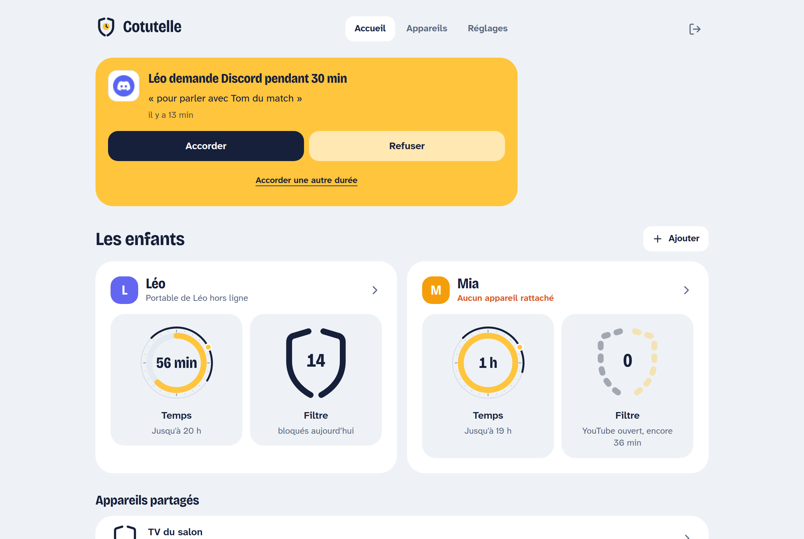
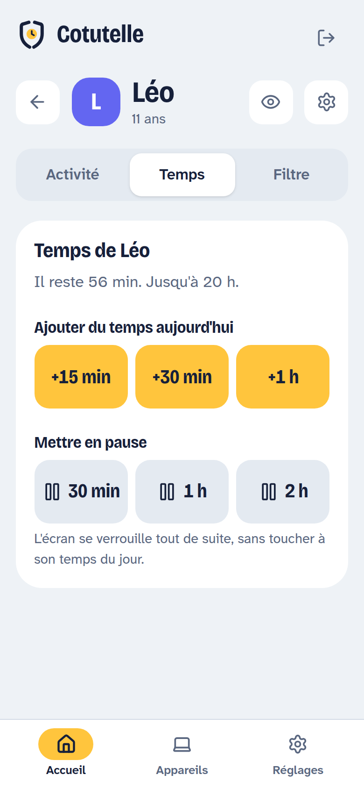
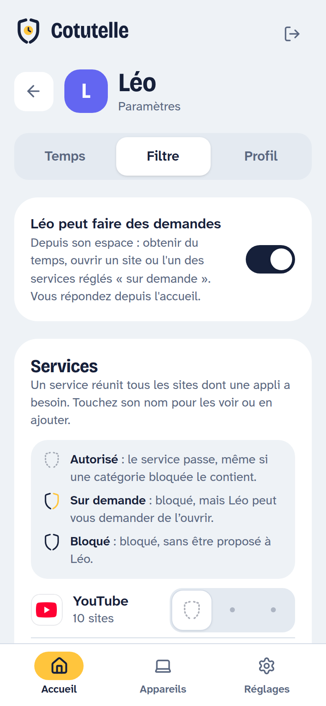
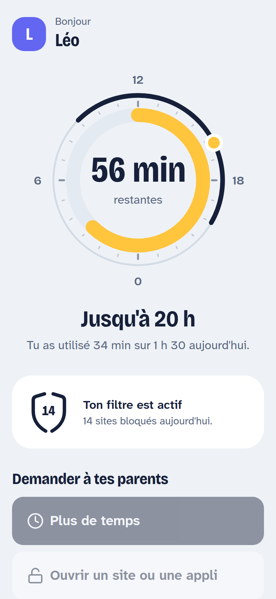
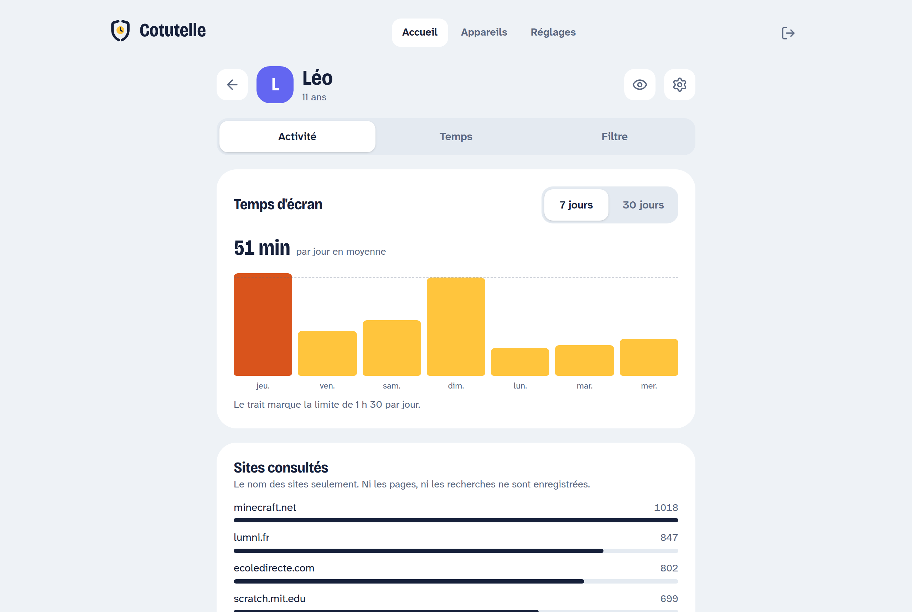

<h1 align="center">
  <br>
  Cotutelle
</h1>

<p align="center">
  Contrôle parental libre pour toute la famille : filtrage des sites, horaires
  et temps d'écran, pilotés depuis une interface web sur le réseau local.
</p>

<p align="center">
  <a href="https://github.com/Dwoinn/cotutelle/releases"></a>
  <a href="https://github.com/Dwoinn/cotutelle/actions/workflows/ci.yml"></a>
  <a href="LICENSE"></a>
</p>

<p align="center">
  <picture>
    <source media="(prefers-color-scheme: dark)" srcset="docs/assets/screenshots/accueil-sombre.png">
    
  </picture>
</p>

## Présentation

Cotutelle protège les enfants d'un foyer sur l'ensemble de leurs appareils,
depuis un seul endroit. Un **serveur** installé sur une machine du réseau
local (Raspberry Pi, NAS, conteneur Docker) porte l'interface des parents et
la configuration ; un **agent** installé sur chaque ordinateur applique les
règles, compte le temps d'écran et verrouille la session quand il le faut.
Les appareils sans agent, télévision ou console, sont filtrés par le DNS du
serveur.

Le projet s'inspire de [CTparental](https://gitlab.com/marsat/CTparental),
dont il reprend l'idée (listes de blocage, horaires, temps de navigation)
mais pas le code : il s'agit d'une réécriture complète, en Rust, conçue dès le
départ pour plusieurs parents, plusieurs enfants et plusieurs appareils. Une
cotutelle est une tutelle exercée à plusieurs.

### État du projet

Cotutelle est en version 0.2.2. Le serveur, l'interface et l'agent Linux
fonctionnent et sont couverts par des tests ; l'agent a été essayé en
conditions réelles sur Ubuntu 24.04 (GNOME) et sur Omarchy (Arch Linux,
Hyprland). Il n'existe pas
encore d'agent pour Windows ni macOS. Les limites connues sont consignées dans
[docs/CADRAGE.md](docs/CADRAGE.md#14-état-de-la-phase-1-et-limites-connues) ;
avant une mise en production dans la famille, faites un premier essai sur une
machine de test.

## Fonctionnalités

**Filtrage des sites par DNS**

- Catégories de sites issues des listes de l'Université Toulouse Capitole
  (5,7 millions de domaines, mises à jour chaque jour par le serveur).
- Services nommés (YouTube, TikTok, Discord…) : chaque service réunit tous les
  domaines dont une application a besoin, et se règle « autorisé », « sur
  demande » ou « bloqué ». Le catalogue se complète depuis l'interface.
- Listes personnelles de sites autorisés ou bloqués, mode restreint YouTube.

**Horaires et temps d'écran**

- Plages horaires par jour et quota quotidien ou hebdomadaire, par enfant,
  partagés entre tous ses appareils.
- Règles distinctes pendant les vacances scolaires.
- Rappels avant la fin, puis verrouillage de la session par l'agent.

**Exceptions et demandes**

- Depuis un téléphone, en un geste : « +30 min », « YouTube pendant 1 h »,
  « pause ». Les exceptions prennent effet en moins d'une minute et expirent
  seules.
- L'enfant peut demander du temps ou l'ouverture d'un service depuis son
  espace ou depuis son bureau ; les parents répondent depuis l'interface ou
  directement depuis la notification sur leur téléphone (via
  [ntfy](https://ntfy.sh), sans compte).

**Suivi transparent**

- Temps d'écran par jour et noms des sites consultés, sans les pages ni les
  recherches.
- L'enfant voit exactement ce que ses parents voient : son espace affiche son
  temps restant, les sites bloqués et l'état de ses demandes.

**Robustesse**

- Hors ligne ou serveur injoignable, l'agent applique la dernière politique
  connue et n'ouvre jamais l'accès par défaut.
- Sur Linux, l'agent détourne le DNS du système vers son propre résolveur,
  interdit le DNS direct aux comptes ordinaires par nftables et désactive le
  DNS chiffré des navigateurs. Tout est restitué à l'arrêt du service.

<table align="center">
  <tr>
    <td align="center">
      <picture>
        <source media="(prefers-color-scheme: dark)" srcset="docs/assets/screenshots/temps-sombre.png">
        
      </picture><br>
      <sub>Ajouter du temps ou mettre en pause</sub>
    </td>
    <td align="center">
      <picture>
        <source media="(prefers-color-scheme: dark)" srcset="docs/assets/screenshots/filtre-sombre.png">
        
      </picture><br>
      <sub>Régler chaque service</sub>
    </td>
    <td align="center">
      <br>
      <sub>L'espace de l'enfant</sub>
    </td>
  </tr>
</table>

<p align="center">
  <picture>
    <source media="(prefers-color-scheme: dark)" srcset="docs/assets/screenshots/activite-sombre.png">
    
  </picture>
</p>

## Architecture

```
  Parents (téléphone, ordinateur)
            │  interface web
            ▼
   ┌─────────────────────┐   DNS du réseau local   ┌──────────────────┐
   │   cotutelle-server  │ ◄────────────────────── │  TV, console…    │
   │  API · politique ·  │                         │  (sans agent)    │
   │  listes · suivi     │                         └──────────────────┘
   └─────────────────────┘
       │            ▲
       │ politique  │ temps d'écran, sites, demandes
       ▼            │
   ┌─────────────────────┐
   │   cotutelle-agent   │  sur chaque ordinateur protégé :
   │  DNS local · temps  │  résolveur filtrant, compteur,
   │  d'écran · verrou   │  verrouillage de session
   └─────────────────────┘
       │
       ▼  cotutelle-session : icône, rappels, demandes dans la session de l'enfant
```

Le serveur décide et distribue ; l'agent applique en local et continue de
protéger hors de la maison. Les deux parlent par une connexion WebSocket
authentifiée, ouverte par l'agent.

| Composant | Rôle |
|-----------|------|
| `cotutelle-server` | API, interface web, hub des agents, DNS filtrant pour le réseau local, téléchargement des listes. Base SQLite intégrée. |
| `cotutelle-agent` | Service système sur l'ordinateur protégé : résolveur DNS filtrant, temps d'écran, verrouillage, protection contre le contournement. |
| `cotutelle-session` | Assistant lancé dans la session graphique de l'enfant : icône de barre avec le temps restant, rappels, explication des fermetures, demandes aux parents. |
| Interface web | Application SvelteKit servie par le serveur, pour les parents et pour l'enfant. |

Les décisions d'architecture et leurs justifications sont dans
[docs/CADRAGE.md](docs/CADRAGE.md).

## Installation

Le guide complet est dans [docs/INSTALLATION.md](docs/INSTALLATION.md). En
résumé, il y a trois étapes.

**1. Le serveur**, une seule fois, sur une machine allumée en permanence :

```bash
docker compose -f docker/compose.yaml up -d
```

Ouvrez ensuite `http://<adresse du serveur>:8080`, créez le compte parent et
ajoutez vos enfants.

**2. L'agent**, sur chaque ordinateur Linux à protéger. Dans l'interface,
« Appareils › Ajouter un ordinateur » affiche un code d'enrôlement ; sur
l'ordinateur :

```bash
sudo apt install ./cotutelle-agent_0.2.2_amd64.deb
sudo cotutelle-agent enroll --server http://<adresse du serveur>:8080 --code XXXX-XXXX
sudo systemctl enable --now cotutelle-agent
```

**3. Les comptes**, de retour dans l'interface : indiquez quel compte de
l'ordinateur appartient à quel enfant. Les comptes des parents restent « non
filtrés ».

### Télécharger

Toutes les versions et leurs sommes de contrôle sont sur la
[page des versions](https://github.com/Dwoinn/cotutelle/releases).

| Agent Linux 0.2.2 | x86_64 | aarch64 |
|-------------------|--------|---------|
| Debian, Ubuntu | [.deb](https://github.com/Dwoinn/cotutelle/releases/download/v0.2.2/cotutelle-agent_0.2.2_amd64.deb) | [.deb](https://github.com/Dwoinn/cotutelle/releases/download/v0.2.2/cotutelle-agent_0.2.2_arm64.deb) |
| Fedora, RHEL, openSUSE | [.rpm](https://github.com/Dwoinn/cotutelle/releases/download/v0.2.2/cotutelle-agent-0.2.2-1.x86_64.rpm) | [.rpm](https://github.com/Dwoinn/cotutelle/releases/download/v0.2.2/cotutelle-agent-0.2.2-1.aarch64.rpm) |
| Autres distributions | [.tar.gz](https://github.com/Dwoinn/cotutelle/releases/download/v0.2.2/cotutelle-agent-0.2.2-linux-x86_64.tar.gz) | [.tar.gz](https://github.com/Dwoinn/cotutelle/releases/download/v0.2.2/cotutelle-agent-0.2.2-linux-aarch64.tar.gz) |

Les paquets demandent la glibc 2.28 ou plus récente (Debian 10, Ubuntu 20.04,
RHEL 8) et un ordinateur avec systemd-resolved et nftables. Les fenêtres de
l'assistant de session demandent GTK 4 et libadwaita.

L'image du serveur existe pour amd64 et arm64 :

```bash
docker pull ghcr.io/dwoinn/cotutelle-server:0.2.2
```

## Développement

Prérequis : Rust (version épinglée par `rust-toolchain.toml`), Node 22, pnpm,
et les en-têtes GTK 4 et libadwaita (`libgtk-4-dev`, `libadwaita-1-dev` sous
Debian et Ubuntu) pour l'assistant de session.

```bash
cargo test --workspace                  # tests Rust
(cd web && pnpm install && pnpm build)  # interface web
cargo run -p cotutelle-server -- --http-addr 127.0.0.1:8087 --data-dir data/dev
scripts/dev-seed.sh                     # famille d'exemple dans l'instance ci-dessus
```

L'instance est alors accessible sur `http://127.0.0.1:8087` avec le compte
« Parent » et le mot de passe indiqué dans `scripts/dev-seed.sh`. Pour
travailler sur l'interface avec rechargement à chaud :

```bash
cd web && COTUTELLE_API=http://127.0.0.1:8087 pnpm dev
```

Pour essayer l'agent sans toucher au système ni verrouiller votre session,
`--dry-run` est indispensable :

```bash
cargo run -p cotutelle-agent -- --state-dir /tmp/agent enroll --server http://127.0.0.1:8087 --code XXXX-XXXX
cargo run -p cotutelle-agent -- --state-dir /tmp/agent run --dry-run --dns-addr 127.0.0.1:15354
dig -p 15354 @127.0.0.1 www.tiktok.com
```

Les captures d'écran de ce fichier se régénèrent avec
`scripts/screenshots.mjs`, à partir de l'instance de développement ci-dessus.

### Structure du dépôt

```
crates/common   modèle du domaine, moteur de filtrage, horaires, protocole (aucune E/S)
crates/dns      relais DNS filtrant, partagé par le serveur et l'agent
crates/server   API, hub des agents, DNS du réseau local, listes de blocage
crates/agent    service installé sur l'appareil protégé
crates/session  assistant de la session graphique de l'enfant
web/            interface SvelteKit et Tailwind (parents et enfant)
packaging/      unité systemd, lanceurs et scripts des paquets .deb et .rpm
docker/         image du serveur, construction des binaires de l'agent, compose d'exemple
deploy/         manifestes OpenShift
scripts/        seed de développement, construction des paquets, captures d'écran
docs/           cadrage, guide d'installation, images
```

Avant de proposer une contribution, lisez [CONTRIBUTING.md](CONTRIBUTING.md)
et vérifiez que `cargo fmt`, `cargo clippy`, `cargo test` et, dans `web/`,
`pnpm check` et `pnpm build` passent.

## Crédits

- [CTparental](https://gitlab.com/marsat/CTparental), pour l'idée.
- Les listes de blocage viennent de l'[Université Toulouse
  Capitole](https://dsi.ut-capitole.fr/blacklists/), sous licence
  CC BY-SA 4.0. Elles sont téléchargées par le serveur, pas redistribuées
  dans ce dépôt.

## Licence

Cotutelle est un logiciel libre sous licence
[GNU AGPL version 3 ou ultérieure](LICENSE). Vous pouvez l'utiliser, le
modifier et le redistribuer, y compris en service hébergé, à deux conditions :

- publier le code source de votre version sous la même licence ;
- conserver l'attribution « Basé sur Cotutelle » dans l'interface.

Le détail est dans [NOTICE.md](NOTICE.md). Le nom et le logo Cotutelle sont
réservés au projet officiel : voir [MARQUE.md](MARQUE.md).
